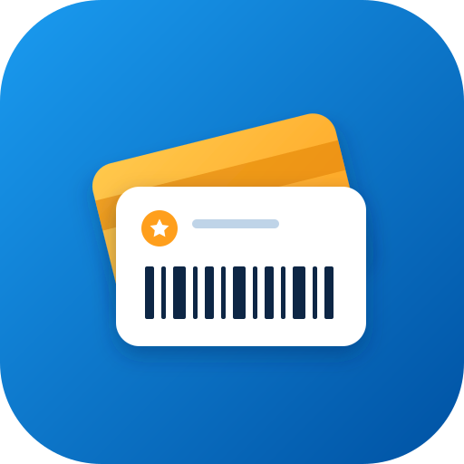

# My Loyalty Cards



A lightweight, privacy-first PWA for storing and displaying your loyalty cards — no account, no server, no tracking.

Your cards live entirely in the URL. Add a card, copy the link, bookmark it or save it to your home screen. That's it.

## Features

- **Scan to add** — point your camera at the barcode or QR code on a physical card and the number and code type are filled in for you
- **Scan from a photo** — pick a photo or screenshot of a card instead of using the live camera
- **Manual entry** — type the card number and tap the preview to switch between Barcode and QR Code
- **Searchable retailer list** — find a store or programme by name or keyword (see [Supported Stores](#supported-stores))
- **URL-based storage** — cards are encoded in the query string; nothing is stored server-side
- **Share via link** — choose which cards to include, then copy the link and send it to yourself or anyone else
- **Import from a link** — opening a shared link lets you add its cards to the ones you already have
- **Backup and restore** — export your cards to a file and import them again on another device
- **Barcode rendering** — each card is shown as a Code 128 barcode or a QR code
- **Full-screen barcode** — tap any barcode to open it full-screen for scanning at the till
- **Offline support** — works without a connection once loaded (PWA service worker), including the scanner
- **Add to Home Screen** — installable on iOS and Android for quick access

## How It Works

### Adding a card

1. Tap **Add Card** and pick the retailer or programme.
2. Either type the card number, or tap **Scan** next to the number field.
3. Check the preview, tap it to switch between Barcode and QR Code if needed, then tap **Add Card**.

### Scanning

Scanning uses [zxing-wasm](https://www.npmjs.com/package/zxing-wasm), a WebAssembly build of ZXing-C++, and runs entirely in your browser — camera frames and photos never leave the device.

- Tapping **Scan** asks for camera permission and opens the rear camera. A frame is decoded roughly every 150 ms until a code is found, then the camera is switched off.
- The decoded text becomes the card number. A QR code is saved as a QR Code card; every other format (EAN-13, Code 128, Code 39, ITF, PDF417, …) is saved as a Barcode card and re-drawn as Code 128.
- **Scan from photo** decodes a picture from your gallery or files instead, which is also the fallback when the camera is blocked or missing.
- The camera only works on a secure origin: `https://` or `localhost`.
- The scanner code and its `.wasm` binary are loaded on first use, not on page load. The binary is served by the app itself (`public/zxing_reader.wasm`, copied from `node_modules` by `scripts/copy-wasm.mjs` before `dev` and `build`), not from a CDN, so the service worker can cache it for offline use.

### Storing and sharing

Cards are written to the page URL (see [URL Format](#url-format)) and mirrored in the browser's local storage, so the bookmark, the home-screen app and a shared link all carry the cards themselves. There is no account and no backend.

## Supported Stores

| Code | Store |
|------|-------|
| `xts` | Checkers Xtra Savings |
| `pnp` | Pick n Pay Smart Shopper |
| `wlw` | Woolworths MyDifference |
| `cls` | Clicks ClubCard |
| `dch` | Dis-Chem Better Rewards |
| `spr` | SPAR Rewards |
| `okf` | OK Count On |
| `mak` | Makro mCard |
| `gme` | Game more rewards |
| `mrp` | Mr Price Reward |
| `smw` | Sportsman's Warehouse |
| `tsp` | TOPS at SPAR |
| `med` | MediRite |
| `cna` | CNA |
| `flm` | Food Lover's Market |
| `spu` | Spur Family Card |
| `dis` | Discovery Vitality |
| `fnb` | FNB eBucks |
| `cap` | Capitec Live Better |
| `tfg` | TFG Rewards |
| `mtn` | MTN mpulse |
| `eng` | Engen |
| `lka` | Lekka |
| `bld` | Builders Warehouse |
| `pkr` | Parkrun |
| `clc` | Cell C |
| `tru` | Toys R Us |
| `skr` | Ster Kinekor |
| `dsm` | Discovery Medical Aid |
| `idn` | ID Number |
| `itn` | Income Tax Number |
| `pst` | Passport Number |
| `vra` | Virgin Active |
| `mop` | Mopani Pharmacy |

## URL Format

```
/?cards=mop:ABC123:bar,pnp:XYZ789:qr
```

Each card is encoded as `company:cardNumber:barcodeType`, comma-separated.

## Tech Stack

- [Next.js 16](https://nextjs.org) + React 19
- [Tailwind CSS v4](https://tailwindcss.com) + [daisyUI 5](https://daisyui.com)
- [bwip-js](https://github.com/metafloor/bwip-js) for barcode rendering
- [zxing-wasm](https://github.com/Sec-ant/zxing-wasm) for barcode and QR code scanning
- [@ducanh2912/next-pwa](https://github.com/DuCanhGH/next-pwa) for PWA support

## Development

```bash
bun dev
```

Open [http://localhost:3000](http://localhost:3000).

## Build

```bash
bun run build --webpack
bun start
```
